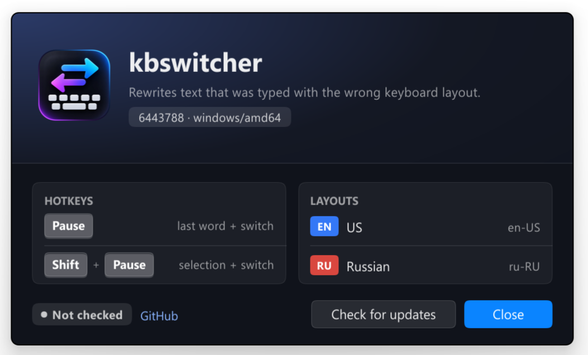

# kbswitcher

[](https://github.com/zakonnic/kbswitcher/releases)
[](go.mod)
[](#installation)
[](LICENSE)

**Rewrites text that was typed with the wrong keyboard layout.**

**No keylogger.** kbswitcher does not watch what you type. The operating system wakes it only when its hotkey is
pressed; no other keystroke ever reaches the process, and nothing is buffered. See [How it works](#how-it-works).

<p align="center">
  
</p>

## Table of Contents

- [Installation](#installation)
  - [Windows](#windows)
  - [macOS](#macos)
  - [Linux](#linux)
- [Usage](#usage)
- [Settings](#settings)
- [How it works](#how-it-works)
- [Limitations](#limitations)
- [Development](#development)
- [Security](#security)
- [License](#license)

## Installation

Download the archive for your platform from the [releases](https://github.com/zakonnic/kbswitcher/releases) page,
unpack it anywhere and start `kbswitcher`. Settings → *Start when I log in* adds it to autostart; About →
*Check for updates* installs a newer release in place. Only one copy runs at a time: starting kbswitcher while it is
already running exits quietly, so an autostart entry and a manual launch never fight over the hotkeys.

Or build it yourself (Go 1.26+, cgo):

```sh
make build          # builds into bin/
make bundle         # macOS: wraps the binary in bin/kbswitcher.app

# make help         # list all targets
```

| Platform | Build needs                                                                    |
|----------|--------------------------------------------------------------------------------|
| Windows  | a C compiler (MinGW-w64 or the MSVC build tools), for the GUI toolkit          |
| macOS    | Xcode command line tools                                                       |
| Linux    | `libx11-dev`, `libxtst-dev`, `libxkbcommon-dev`, `libgl1-mesa-dev`, `xorg-dev` |

### Windows

Nothing to grant: a hotkey, key presses and the clipboard need no permission. SmartScreen may warn about an unsigned
download on the first start.

### macOS

kbswitcher replaces text by pressing keys on your behalf, which macOS guards with the **Accessibility** permission.
The first start asks for it; grant it in *System Settings → Privacy & Security → Accessibility*, then restart the
app. Until then the hotkeys do nothing.

On a MacBook, `F12` only reaches applications when *Use F1, F2, etc. keys as standard function keys* is on, or when
`fn` is held. If that does not suit you, pick another key in Settings.

### Linux

kbswitcher needs an X11 session. Under Wayland it works only for applications running through XWayland, because
Wayland deliberately offers no way to grab a global hotkey or to type into another application's window.

## Usage

| Hotkey                                | What it does                                                                                     |
|---------------------------------------|--------------------------------------------------------------------------------------------------|
| **Break** (**F12** on a Mac)          | Rewrites the word before the caret and switches the keyboard to the layout that word now belongs to, so you can keep typing. |
| **Shift+Break** (**Shift+F12** on a Mac) | Rewrites the selected text and switches the keyboard the same way. In a Windows terminal it rewrites what the shell shows as selected, or the whole input line when nothing is. |

Press the same hotkey again to move on to the next layout. The hotkey, the modifier that turns it to the selection,
and each of the two layout switches can be changed in Settings.

## Settings

Right-click the tray icon:

- **About** — version, the layouts that were found and the order they are cycled in, and a button that checks for a
  newer release and installs it.
- **Settings** — whether kbswitcher starts with your session; whether converting the last word, and converting a
  selection, also switch the keyboard layout (both on by default); the hotkey; and the modifier that, held with the
  hotkey, converts the selection instead (Shift by default). To change the hotkey, click its field and press a key,
  or a modifier and a key together: at most two keys, and a key used in typing (a letter, a digit, Space, an
  arrow…) needs a modifier. On Windows a letter is the one the layout in use puts on the key, as for any Windows
  shortcut; on macOS and Linux a key is bound by its position. Escape stops listening.
  The hotkeys are released while a field listens, so the current ones can be pressed there too. Save puts the
  settings in force at once; Cancel discards the changes.
- **Quit**.

The configuration is a small JSON file:

| Platform | Location                                               |
|----------|--------------------------------------------------------|
| Windows  | `%AppData%\kbswitcher\config.json`                     |
| macOS    | `~/Library/Application Support/kbswitcher/config.json` |
| Linux    | `~/.config/kbswitcher/config.json`                     |

A log of the current run is written to the user cache directory (`%LocalAppData%\kbswitcher\`,
`~/Library/Caches/kbswitcher/kbswitcher.log`, `~/.cache/kbswitcher/`) and rewritten at every start. Run with
`-verbose` to log every conversion.

## How it works

kbswitcher asks the operating system to notify it about two key combinations, the hotkey and the same with the
selection modifier — `RegisterHotKey` on Windows, `RegisterEventHotKey` on macOS, `XGrabKey` on X11 — and is woken
up only when one of them is pressed.

When the hotkey fires, it does what you would do by hand, in one of three ways, depending on where the caret is.

**A text field that tells its text** (on Windows: browsers and Electron applications, WPF, WinUI, RichEdit, the
classic edit controls of dialogs and Windows Forms). kbswitcher reads the line around the caret the way a screen
reader does — UI Automation, or the edit control's own messages — and then types the fix: Backspace over the word,
and the word in the right layout. The clipboard is not touched and no shortcut is pressed. The selection hotkey
erases the selection with Backspace and types its conversion.

A field may not show yet what was typed into it a moment ago: a busy page takes in keys late, and its accessibility
tree is later still (up to 150 ms measured). So kbswitcher presses `Shift`+`Left` and waits for the field to show one
character selected. That key queues behind everything typed before it, and nothing else you type or press selects a
single character, so the field then shows all of it. The `Right` key that drops the selection opens the burst that
retypes the word. A field that does not show the selection within a second is left alone.

**A terminal** (on Windows). The shell's input line is read and rewritten in place through the console API; no
key reaches the shell but the ones it would get from you.

**Anything else** (editors that draw their own text, such as VS Code's and the JetBrains IDEs', and every
application on macOS and Linux) goes through the clipboard:

1. select from the caret to the start of the line, with one key press, and copy (skipped for the selection hotkey —
   you have already selected the text);
2. work out which layout the last word was typed in, and rewrite it for the next one;
3. select exactly that word and cut it;
4. paste the result where the word was, and give your clipboard back.

The line is selected by a single key press and the word is cut rather than pasted over because of editors driven by
scripts: they learn of a keyboard selection late, and until then copy one range and paste over another. A selection
made by one press cannot be caught halfway, and what a cut puts on the clipboard is what it removed. On Windows,
what kbswitcher puts on the clipboard along the way is marked so that clipboard history and cloud clipboard sync
leave it out, and the clipboard is given back a quarter of a second after the pasted text was read off it.

The layouts come from the same tables the operating system uses to turn key presses into characters: `ToUnicodeEx`
on Windows, `UCKeyTranslate` on macOS, the XKB keymap on X11.

## Limitations

- **Terminals kbswitcher cannot read.** Git Bash in its own window (mintty) has no Windows console at all, and there
  the hotkey does nothing. A JetBrains IDE, Tabby, or a terminal that draws its own window, does not say where its
  focus is, so kbswitcher presses Left and Right once to see whether a shell moves its caret; with the focus in the
  IDE's editor that costs a tenth of a second. A Tabby pane whose shell does not answer (an empty line, a program
  running in it) is left alone. With the caret at the very start of a shell's line that probe leaves it one
  character to the right. On macOS and Linux every terminal takes the clipboard path.
- **Retyping is typing.** In a field that tells its text, the fix is typed, so an editor treats it as typed: a code
  editor may close a bracket or open its completion list, as it would for you. A word with combining marks or emoji
  in it, and a selection over several lines, go through the clipboard instead.
- **Clipboard readers.** On the clipboard path, a program that opens the clipboard on every change (WSLg, remote
  desktop clients, clipboard managers) can hold it at the moment the application copies or pastes, and a classic
  edit control does not try again. Fields that tell their text avoid the clipboard for exactly this reason.
- **The last word is looked for on the caret's line only.** With the caret at the very start of a line the hotkey
  does nothing.
- **Selections in a terminal.** A selection made with the mouse belongs to the terminal window and no shell knows of
  it, so `Shift`+hotkey converts what the shell itself shows as selected (`Shift`+arrows in PowerShell), and the
  whole input line otherwise. In the terminal of a JetBrains IDE the whole line takes most of a second, because the
  window is tried as an editor first.
- **Formatting.** The replacement is pasted as plain text. In a rich text editor the word that was replaced loses its
  formatting; the rest of the line does not, because only the word is cut.
- **Characters that need AltGr.** Only unshifted and shifted key presses are reproduced. Anything typed with a third
  or fourth level is copied through unchanged.
- **Clipboard formats other than text, rich text, images and file lists** are not restored after a conversion, and
  content larger than 8 MB is left behind rather than copied aside.

## Development

```
cmd/kbswitcher           the program itself: flags, logging, start-up
internal/keymap          the conversion core — no operating system anywhere in it
internal/switcher        what a hotkey press does, start to finish
internal/platform        everything the operating system provides:
    hotkey                 registering a system-wide key combination
    input                  pressing keys in the focused window
    field                  reading the focused text field around the caret, without the clipboard
    uia                    a small UI Automation client
    console                reading and rewriting a Windows console input line
    layouts                reading the installed layouts and their characters
    clip                   borrowing and giving back the clipboard
internal/config          the settings file
internal/autostart       the "start with the session" entry
internal/singleinstance  the lock that keeps a second copy from running
internal/updater         checking for and installing a release
internal/ui              tray icon, Settings and About
tools/stand              Windows test stand for terminals, editors and text fields
tools/uiaread            prints what UI Automation reports about the focused field
```

The conversion core has no dependency on any operating system and is covered by tests, including a simulated text
field that exercises select-copy-convert-paste end to end.

```sh
make check          # format, vet and test
make test-race      # tests under the race detector
make lint           # golangci-lint, settings in .golangci.yml
make dist           # package bin/ and append to bin/checksums.txt, as a release expects
```

`tools/stand` opens a real console, Windows Terminal, an isolated VS Code or Notepad, types a word, converts it and
checks what the window shows. `go run ./tools/stand -help` lists its options.

### Releasing

```sh
make release V=1.2.3          # asks before the push; YES=1 does not
make release-verify V=1.2.3   # after publishing on GitHub
```

On a clean `main`, `make release` checks formatting, vets, lints and runs the tests under the race detector, tags
`v1.2.3` (refusing a version not newer than the last tag), packages the archive with `checksums.txt`, asks, and
pushes `main` and the tag together. Anything that stops before the push deletes the tag again, so the same version
can be cut once the cause is fixed; once origin has the tag, a fix needs the next version. It then prints what is left
on GitHub: publish a release from the tag with both files attached. The updater reads only the latest published
release; drafts and pre-releases are invisible to it, and it refuses a release without `checksums.txt`.
`make release-verify` checks that GitHub serves the new release as the latest, with the archive and a `checksums.txt`
that vouches for the archive built here.

The build needs cgo, so each platform's archive is made on that platform with `make dist VERSION=v1.2.3` and added to
the same release, its line appended to the same `checksums.txt`. `make release-check`, `make tag`, `make untag` and
`make push` are the steps on their own.

## Security

[SECURITY.md](SECURITY.md) describes what kbswitcher can reach, what it deliberately cannot, and the trust model of
the update button. It is the place to start for a review.

Third-party dependencies: [Fyne](https://fyne.io) for the tray icon and the two windows,
[golang.design/x/clipboard](https://github.com/golang-design/clipboard) for the clipboard on macOS and Linux, and
`golang.org/x/sys` for the Windows system calls.

## License

[MIT](LICENSE)
